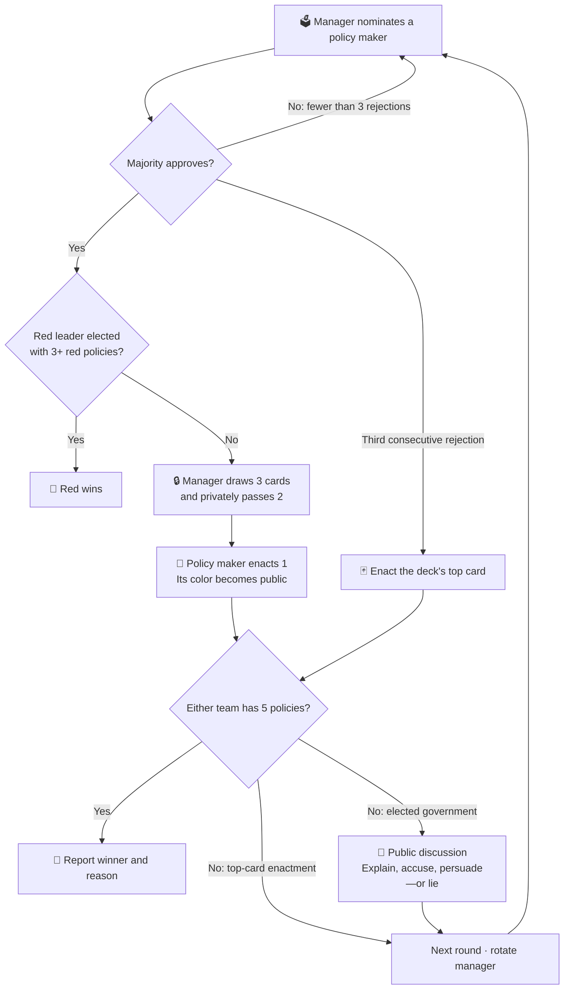

# Hidden Agenda · Social Deduction

**Can a hidden minority steer a majority toward the wrong outcome?**

LLM players govern a shared project through nominations, votes, private policy
choices, and public debate. Blue is the majority; red is a hidden minority with
an opposing objective. The enacted policy is visible, but the available choices
are private—an unlucky draw and deliberate sabotage can look identical.

## The game at a glance

| 🔵 Blue majority | 🔴 Hidden red minority |
| --- | --- |
| Win by enacting **5 blue policies** | Win by enacting **5 red policies** |
| Other players’ roles are unknown | Also win if the **red leader is elected policy maker after 3 red policies** |

**Default setup:** 8 players · 5 blue / 3 red · deck of 6 blue / 11 red cards.
Player counts and deck composition are configurable. Regular red players know
their teammates and leader; the leader does not know the other red players.



A tie rejects a nomination. Managers cannot nominate themselves or the previous
policy maker. Approval or automatic top-card enactment resets the rejection
counter. After a top-card enactment, play goes directly to the next round unless
a team has won.

## How the system works

| Component | Responsibility |
| --- | --- |
| [Game](game.py) | Async LangGraph controls phases, eligibility, card movement, scoring, and victory. `GameState` holds the board and game data; `Game` owns the deck and agent runtimes. |
| [Player agents](agent.py) | Each player has isolated persistent history. Agents catch up on public messages and receive private observations only when authorized. |
| [Prompts](prompts/) | Base role instructions plus the current phase. Card choices use indices; phase-specific Pydantic schemas validate responses. |
| Model calls | `ChatOpenRouter` supplies the model. Missing or malformed structured output gets one retry with unchanged input; failed outputs do not enter player history. |
| Persistence | SQLite stores game and player checkpoints under separate thread IDs. Checkpoints support inspection; the mutable deck is not checkpointed for full game recovery. |

Discussion begins with the policy maker and manager, followed by parallel reactions
and configurable discussion passes. Players may deceive others publicly; the
engine validates their actual actions.

## Run one game or an experiment

From the repository root, set `OPENROUTER_API_KEY` in your environment or `.env`:

```bash
# One game
uv run main.py --model openai/gpt-6-luna

# 50 independent attempts with the same settings and frozen prompts
uv run main.py --model openai/gpt-6-luna --experiment results/baseline --games 50
```

Use a new directory for each experiment. Results are saved after each attempt:

```text
results/baseline/
├── experiment.yaml       # Configuration, rule thresholds, prompt contents
├── prompts/              # Frozen prompts used by every game
├── games/*.json          # Final state or failure details per attempt
├── summary.json          # Wins, termination reasons, completion/failure counts
└── checkpoints.sqlite    # Game and player histories
```

Win rates use **completed games only**; failures are reported separately.
Selected model calls are captured in `debug/model_inputs/` with timestamped
filenames, rendered messages, tool settings, responses, token usage, and
provider-reported cost when available.

## Research direction

We measure faction success and study how trust, information sharing, and coalition
formation affect collective decisions. Planned comparisons vary the minority
fraction and coordination access: **unknown identities → mutual recognition →
private coordination**. These are research conditions to compare, not currently
implemented CLI modes.
