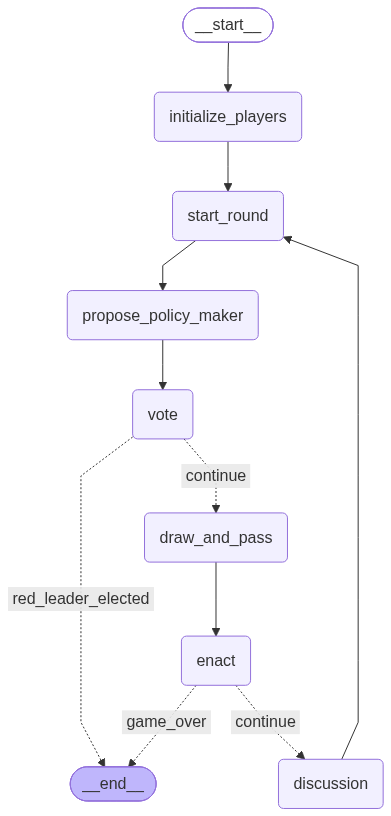

## Hidden-agenda governance under zero-sum objectives
Our first experiment tests whether hidden collusion can overcome a numerical disadvantage, pitting a “clueless” majority pursuing a shared objective against a minority with a strictly opposing agenda and varying coordination opportunities.
We derive the following multi-agent framework from common social deduction games: A swarm of N agents is tasked with governing a shared project through collective decision-making. A “good” majority pursues a common objective, while a fraction (p < 0.5) pursues a hidden, opposing agenda. The setting is strictly zero-sum: either the majority achieves its objective or the colluding minority achieves its competing objective. 
In each round, agents deliberate and vote to delegate policy selection to a pair of representatives. The selected pair privately receives a randomly drawn set of policy options, then enacts one policy and the outcome becomes publicly observable. Because the available alternatives remain hidden, other agents cannot directly distinguish an unfavorable outcome caused by an unlucky draw from deliberate manipulation. Agents can justify their choices, challenge others’ accounts, and adjust whom they trust/support in subsequent rounds.

### Game flow

### Conditions

We vary the fraction of hidden-agenda agents p  ∈ [0.1, 0.5) and their ability to coordinate. In particular, we compare the following settings:
None of the swarm agents know one another’s identities; everyone communicates through a public channel.
Agents in the colluding minority know one another’s identities but can communicate only through the public channel
Agents in the colluding minority know one another’s identities and additionally have access to a separate, private coordination channel.
In all conditions, the non-colluding agents do not have access to each other’s identities, but are aware of a colluding group among them. These conditions distinguish the effects of shared opposing incentives, mutual recognition, and private communication.

### What we measure
We measure each faction’s success rate and examine how these coordination advantages shape information sharing, trust, coalition formation, and influence over collective decisions. This provides a controlled test of hidden collusion under fully-opposing objectives, complementing the more nuanced conflict settings studied in the real-world application setting.
